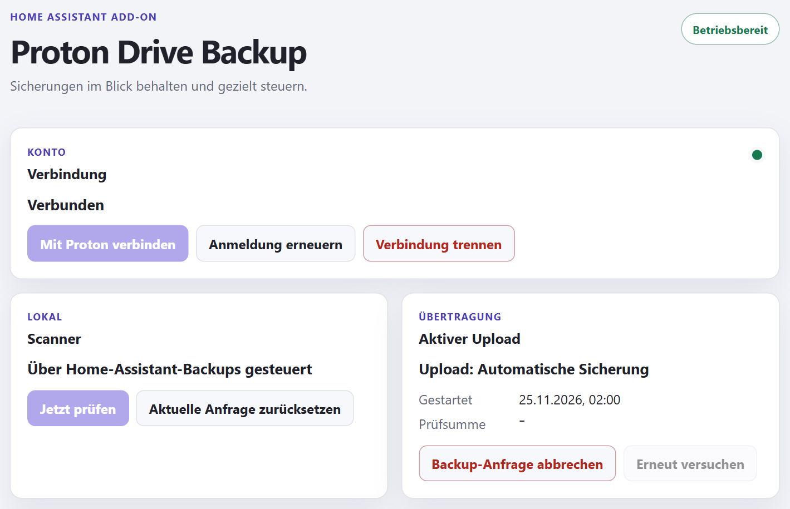
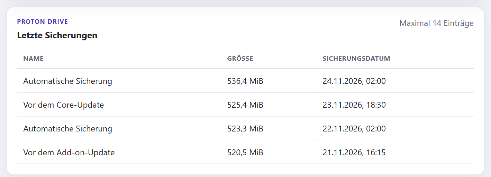

# Proton Drive Backup für Home Assistant OS

Diese App verbindet Home Assistant mit deinem Proton Drive. Sie meldet dich bei Proton an, überträgt fertige Backup-Archive und zeigt, **welche Sicherung zuletzt bestätigt wurde**. Den Zeitplan und die Backup-Inhalte verwaltest du weiterhin in Home Assistant.

[Zum Handbuch](HANDBUCH.md) · [Integration für das Backup-Menü](https://github.com/Fighterbomber001/Proton-drive-4-Homeassistant)

## Während des Uploads

*Beispielansicht mit erfundenen Daten.* Unter **Aktiver Upload** siehst du, welches Archiv gerade übertragen wird. **Ausstehende Uploads** zählt nur die wartenden Aufträge – eine Null bedeutet also nicht, dass der aktive Upload fertig ist.

## Nach der Bestätigung

Die Tabelle zeigt bis zu **14 bestätigte Sicherungen**, neueste zuerst. Das Sicherungsdatum des ersten Eintrags erscheint auch unter **Letzte bestätigte Sicherung**. Die 14 Zeilen begrenzen nur die Anzeige: Die native Anbindung löscht keine Proton-Kopien. Beim Öffnen lädt das Dashboard den Status sofort; solange es sichtbar bleibt, fragt es ihn alle 30 Sekunden für höchstens zehn Minuten erneut ab. Geplante Backups laufen auch bei geschlossenem Dashboard.

## Installation und Betrieb

- **Voraussetzungen:** Home Assistant OS auf amd64 (x86-64), Home Assistant Core ab 2026.11.2 und ein Proton-Konto mit genügend Speicher.
- **App installieren:** Füge dieses Repository im **App-Store** von Home Assistant hinzu. Die App-Konfiguration, die Proton-Anmeldung und den lokalen Kopplungsschlüssel erklärt das [Handbuch](HANDBUCH.md).
- **Sicherungsort aktivieren:** Installiere zusätzlich die [Integration](https://github.com/Fighterbomber001/Proton-drive-4-Homeassistant) über den **Marketplace** und wähle **Proton Drive** im normalen Backup-Menü.
- **Wiederherstellung erproben:** Lade ein Testarchiv von Proton Drive herunter. Dabei prüft die App Größe und SHA-256. Bewahre den Home-Assistant-Notfallschlüssel und eine weitere Sicherung unabhängig auf; ein erfolgreicher Download allein ist noch kein System-Restore.

[Handbuch](HANDBUCH.md) · [Sicherheit](SECURITY.md) · [Disclaimer](DISCLAIMER.md)

Dies ist ein unabhängiges Community-Projekt, kein offizielles Produkt von Proton oder Home Assistant. „Proton“ und „Proton Drive“ sind Marken der Proton AG; siehe [Protons Nutzungsbedingungen](https://proton.me/legal/terms), Abschnitt 8. Die App lädt die Proton-CLI von Proton beim Erstellen des App-Images herunter. Die CLI ist nicht Teil des Repository-Quellcodes.
